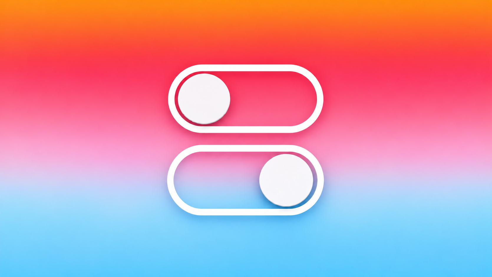
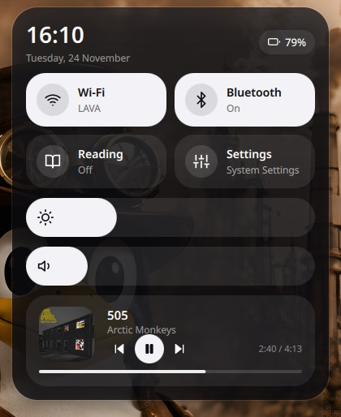

<div align="center">



# KDE Island

A dynamic-island style command center for KDE Plasma on Wayland.

<p align="center">
  
</p>
<p align="center">
  
</p>

</div>

---

## Overview

KDE Island is a sleek, floating status widget and command center designed specifically for KDE Plasma on Wayland. It docks at the top-center of the screen as an unobtrusive pill. When clicked, it smoothly morphs into an expanded control panel providing rapid access to audio, brightness, connectivity, system settings, and media playback.

The widget uses the Wayland layer-shell protocol with dynamic input region masking. When closed, only the pill intercepts pointer events, allowing windows and the desktop behind the rest of the screen to remain completely clickable and interactive.

---

## What It Does

- **Dynamic Pill State**:
  - Sits at the top-center edge of the screen.
  - Gently enlarges on mouse hover to indicate interactive state.
  - Automatically widens when audio is playing to show track album art alongside an animated audio equalizer.

- **Morphing Control Panel**:
  - Expands with smooth spring easing animations.
  - Dismisses instantly when pressing Escape or clicking anywhere outside the panel.

- **System Quick Toggles**:
  - **Wi-Fi**: Toggles wireless radio on and off; displays current active SSID via NetworkManager.
  - **Bluetooth**: Toggles Bluetooth adapter power; displays connected device name via BlueZ.
  - **Reading Mode**: Activates a warm screen tint via KDE Night Light (constant color temperature mode) while preserving your previous night color settings for restoration when turned off.
  - **System Settings**: One-click shortcut to launch the native KDE System Settings app.

- **Precision Sliders**:
  - **Volume Slider**: Adjusts default audio sink volume through PipeWire. Supports dragging, clicking, and mouse-wheel scrolling. Clicking the speaker icon toggles mute.
  - **Brightness Slider**: Regulates display backlight using KDE PowerDevil over D-Bus with a fallback to brightnessctl.

- **Media Player**:
  - Compact MPRIS player interface displaying album art, track title, and artist name.
  - Full transport controls: previous track, play/pause, and next track.
  - Real-time timestamp display and an interactive seek bar for scrubbing through tracks.

- **Clock and Battery Status**:
  - Digital clock supporting 12-hour or 24-hour display format and current date.
  - Battery charge percentage and active charging indicator via UPower.

---

## How You Can Use It

### Requirements

- KDE Plasma 6 running on **Wayland**
- **Quickshell** (available on Fedora via COPR, Arch via AUR, or source)
- Supporting system packages:
  - `pipewire`, `wireplumber`
  - `NetworkManager` (`nmcli`)
  - `bluez` (`bluetoothctl`, `rfkill`)
  - `systemd` (`busctl`)
  - `kwriteconfig6`, `kreadconfig6` (KDE Plasma default)
  - Optional: `brightnessctl` (used as fallback for brightness control)

### Running Directly

You can test KDE Island directly from the project directory without installing anything to system folders:

```bash
git clone https://github.com/adityajha-coder/kde_commandcentre_island.git
cd kde_commandcentre_island
quickshell -p .
```

### Installation

To install KDE Island to your user configuration directory and enable automatic launch on login:

```bash
# Ensure helper scripts have executable permissions
chmod +x install.sh scripts/reading-mode.sh

# Run the installer with autostart enabled
./install.sh --autostart
```

To start the application immediately in the background:

```bash
quickshell -c kde-island & disown
```

### Controls

| Action | Result |
|---|---|
| Hover the pill | Pill expands slightly |
| Click the pill | Opens the command center panel |
| Press Escape or click outside | Closes the panel |
| Drag or scroll over volume slider | Changes output volume |
| Click volume icon | Toggles mute |
| Drag or scroll over brightness slider | Changes screen brightness |
| Click media progress bar | Seeks to that track position |

---

## How You Can Edit Command Centre

KDE Island uses a JSON configuration file located at:

```
~/.config/kde-island/config.json
```

Any changes saved to this file **hot-reload instantly** in real time without needing to restart Quickshell.

### Configuration Options

| Key | Description | Default |
|---|---|---|
| `monitor` | Monitor output name (e.g. `eDP-1`, `DP-1`). Leave empty for primary display. | `""` |
| `topMargin` | Vertical margin from top edge of the screen in pixels. | `8` |
| `pillWidth` | Width of the idle pill in pixels. | `124` |
| `pillHeight` | Height of the idle pill in pixels. | `32` |
| `panelWidth` | Width of the expanded command center in pixels. | `392` |
| `cornerRadius` | Corner radius of the expanded panel in pixels. | `32` |
| `tint` | Hexadecimal color code for the panel glass background. | `"#0c0c10"` |
| `glassOpacity` | Background opacity (0.0 for completely transparent, 1.0 for solid). | `0.8` |
| `accent` | Accent color for active toggle buttons and slider fills. | `"#f2f2f7"` |
| `borderGlow` | Brightness intensity of the outer border highlight. | `0.1` |
| `animationSpeed` | Animation speed multiplier (1.0 = standard speed, 2.0 = twice as fast). | `1.0` |
| `use24h` | Clock format (`true` for 24-hour format, `false` for 12-hour AM/PM). | `true` |
| `readingTemperature` | Color temperature in Kelvin when Reading Mode is enabled. | `3600` |

### Example Custom Configuration

To edit the configuration, open the file in your preferred text editor:

```bash
kate ~/.config/kde-island/config.json
# or
nano ~/.config/kde-island/config.json
```

Example content:

```json
{
  "monitor": "",
  "topMargin": 12,
  "pillWidth": 130,
  "pillHeight": 34,
  "panelWidth": 420,
  "cornerRadius": 28,
  "tint": "#101018",
  "glassOpacity": 0.85,
  "accent": "#5294e2",
  "borderGlow": 0.15,
  "animationSpeed": 1.2,
  "use24h": true,
  "readingTemperature": 3400
}
```

---

## License

This project is licensed under the [GNU General Public License v3.0](LICENSE).

